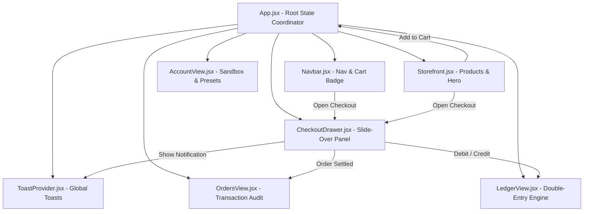

# FinCommerce — UI Architecture & Context Specification

## 1. Executive Overview

**FinCommerce** is an enterprise-grade developer commerce platform built with a high-performance modern fintech aesthetic (inspired by Stripe, Vercel, and modern SaaS dashboards). The frontend is built on **React 18** and bundled with **Vite**, utilizing custom design tokens layered on **Tailwind CSS**.

The interface combines a digital software storefront with real-time distributed systems observability:
- **Idempotent Payment Engine**: Guarantees zero duplicate charges when shoppers or automated tools re-submit requests.
- **Double-Entry Financial Ledger**: Visualizes real-time debit and credit postings conforming to the fundamental accounting equation ($\text{Assets} = \text{Liabilities} + \text{Equity}$).
- **Fraud Risk Quarantine & DLQ Management**: Routes high-risk transactions ($\ge 70$ risk score) to an AWS EventBridge / SQS Dead-Letter Queue while displaying clean, user-friendly guidance instead of raw server stack traces.

---

## 2. Directory Structure & File Map

```text
frontend/
├── index.html                     # Entry HTML, SEO meta tags, Inter & JetBrains Mono fonts
├── index.css                      # Tailwind base + custom glassmorphism, animations & toast styles
├── tailwind.config.js             # Extended color palette, fonts, keyframes, box shadows
├── vite.config.js                 # Vite bundler configuration & proxy routes
├── public/
│   ├── algo_trading.jpg           # Algorithmic Trading Starter Kit card asset
│   ├── eventbridge.jpg            # EventBridge Integration Blueprint card asset
│   └── ledger_core.jpg            # Distributed Ledger Core License card asset
└── src/
    ├── main.jsx                   # React root entry, wraps App with ToastProvider
    ├── App.jsx                    # Root state coordinator (cart, orders, tabs, checkout drawer)
    ├── components/
    │   ├── Navbar.jsx             # Sticky glassmorphism header, brand logo, nav links, cart badge
    │   ├── CheckoutDrawer.jsx     # Slide-over checkout drawer, 18% GST, card presets, idempotency
    │   ├── ToastProvider.jsx      # Context-based animated toast notification provider
    │   ├── EventQueueMonitor.jsx  # EventBridge & SQS telemetry stream monitor
    │   ├── FraudQueue.jsx         # Quarantined fraud orders viewer
    │   └── LedgerTable.jsx        # General ledger tabular viewer
    └── pages/
        ├── Storefront.jsx         # Hero banner, product catalog grid, floating cart bar
        ├── OrdersView.jsx         # Transaction history, search/filter, audit receipt modal, retry
        ├── LedgerView.jsx         # Double-entry ledger viewer & accounting equation verification
        ├── AccountView.jsx        # Engineer profile, test card presets, fraud threshold controls
        ├── AdminDashboard.jsx     # Metrics telemetry and manual DLQ replayer
        └── Login.jsx              # Enterprise authentication screen
```

---

## 3. UI Flow & State Hierarchy



---

## 4. Detailed Component Specifications

### 4.1. Navigation Header (`Navbar.jsx`)
- **Sticky Glassmorphism**: `backdrop-blur-xl`, `rgba(15, 23, 42, 0.85)` background with subtle bottom border (`#1e293b`).
- **Brand Identity**: Custom SVG vector glyph in a glowing gradient container (`#3b82f6` to `#10b981`), titled **FinCommerce** (*"Developer Commerce"*).
- **Navigation Tabs**:
  - `Store` (ShoppingBag) — Product catalog and hero showcase
  - `Orders` (BookOpen) — Transaction audit log and status badges
  - `Ledger` (BarChart3) — Double-entry accounting journal
  - `Account` (User) — Engineer identity and developer sandbox
- **Live Cart Badge**: Displays real-time quantity badge with scale animation; clicking opens the slide-over drawer.
- **Mobile Responsive**: Scrollable horizontal navigation bar on small viewports.

### 4.2. Storefront & Catalog (`Storefront.jsx`)
- **Ambient Hero Section**: Glowing gradient orbs (`blue-600`, `emerald-600`, `violet-600`), badge tag (*"Developer-First Commerce Platform"*), and headline.
- **Product Catalog**:
  1. **Algorithmic Trading Starter Kit** — `$299.00 USD` (Image: `/algo_trading.jpg`, Badge: `Popular`)
     - Low-latency execution strategies, backtesting framework, risk primitives.
  2. **EventBridge Integration Blueprint** — `$149.00 USD` (Image: `/eventbridge.jpg`)
     - Production AWS EventBridge rules, SQS consumers, and DLQ patterns.
  3. **Distributed Ledger Core License** — `$499.00 USD` (Image: `/ledger_core.jpg`, Badge: `Enterprise`)
     - GAAP-compliant double-entry accounting engine with immutable audit trails.
- **Product Card Interactions**: Smooth hover elevation (`translate-y-1.5`), image zoom (`scale-108`), feature pills, and "Add to Cart" with bounce feedback.
- **Floating Checkout Bar**: Docked bottom-center pill displaying total items, price in USD, and quick checkout arrow when `cart.length > 0`.

### 4.3. Slide-Over Checkout Drawer (`CheckoutDrawer.jsx`)
- **Slide-In Animation**: Smooth transition from right edge with dimmed backdrop (`slate-950/80`).
- **Cart Review**: Line items with `+` / `-` quantity adjustments and trash deletion.
- **Financial Calculations**:
  - Subtotal: $\sum (\text{Price} \times \text{Quantity})$
  - **GST Tax (18%)**: $\text{Subtotal} \times 0.18$ (representing CGST 9% + SGST 9%)
  - **Total**: $\text{Subtotal} + \text{Tax}$
- **Simulated Test Cards**:
  - **Standard Card** (`4242 4242 4242 4242`): Low risk score (~10), instant settlement, writes balanced ledger entry.
  - **High-Risk DLQ Card** (`9999 9999 9999 9999`): High risk score ($\ge 70$), quarantines to DLQ, triggers clean verification toast.
- **Idempotency Safeguard Widget**:
  - Unique idempotency key generated per session (`idem_<random>_<timestamp>`).
  - Copy to clipboard & regenerate buttons.
  - **"Lock key (Test idempotency duplicate rejection)"** checkbox: Allows demonstrating backend duplicate rejection and replay protection.
- **Payment Button**: Animated loading spinner, lock icon, and SSL/EventBridge security badges.

### 4.4. Orders & Settlements (`OrdersView.jsx`)
- **Search & Filter**: Search by Order ID, Transaction Ref (`TXN_...`), or Idempotency Key. Filter by `All`, `Succeeded`, or `Quarantined / Pending`.
- **Status Badges**:
  - `Succeeded` (Emerald badge): Settled and ledger verified.
  - `Pending Verification (DLQ)` (Amber badge): Quarantined due to risk evaluation.
  - `Failed` (Rose badge): Execution failure.
- **Actions**:
  - Copy TXN or Idempotency Key in one click.
  - **"Verify & Settle"** button on pending orders: Replays quarantined order to the ledger and updates status to `Succeeded`.
  - Detailed **Audit Receipt Modal**: Item breakdown, risk score, and settled amounts.

### 4.5. Double-Entry General Ledger (`LedgerView.jsx`)
- **Fundamental Accounting Equation Card**:
  $$\text{Assets (Debits)} = \text{Liabilities (Credits)} + \text{Equity (Credits)}$$
  - Displays a green verified badge when balanced: `Equation Balanced: Assets = Liabilities + Equity`.
- **Account Summary Metrics**:
  - **Total Assets**: Debits to `1010 - Cash & Receivables`
  - **Total Liabilities**: Credits to `2020 - GST Output Tax Payable`
  - **Total Equity**: Credits to `4010 - Software Sales Revenue`
- **Journal Table**:
  - Timestamp, Order Ref, Account Code, Type (`DEBIT` in blue / `CREDIT` in emerald), Amounts, and Status.
  - Filter by `All Accounts`, `Assets`, `Revenue`, or `GST Liabilities`.

### 4.6. Account & Developer Sandbox (`AccountView.jsx`)
- **Engineer Profile**: Identity card for Staff FinTech Engineer with active permissions.
- **One-Click Test Cards**: Quick copy for standard and fraud trigger card numbers.
- **Sandbox Controls**:
  - Idempotency Guard toggle
  - Fraud Quarantine Threshold slider ($50 - 95$, default $70$)
  - Connected Infrastructure Status (Node.js Server, EventBridge Bus, Double-Entry DB, Idempotency Cache)
  - **"Purge Quarantined DLQ Events"** button to flush the queue.

### 4.7. Toast Notification System (`ToastProvider.jsx`)
Context-based global toast notifications supporting 5 message classifications:
1. `success`: Payment completed, item added, order settled (Emerald).
2. `warning`: Payment flagged for verification / high-risk (Amber).
3. `error`: Payment or connection failure (Rose).
4. `info`: Copied to clipboard, key generated (Blue).
5. `idempotent`: Specialized Zap icon for duplicate request notices (Violet/Amber).

---

## 5. Design Tokens & Styling Guidelines

| Category | Token / Class | Value / Description |
| :--- | :--- | :--- |
| **Background** | `bg-[#0f172a]` | Deep slate fintech dark mode |
| **Surface (Card)** | `bg-slate-900/60` | Semi-transparent card with backdrop blur |
| **Border** | `border-slate-800` | Subtle clean boundary (`#1e293b`) |
| **Primary Brand** | `text-blue-500`, `bg-blue-600` | Developer primary accent (`#3b82f6`) |
| **Success / Settlement**| `text-emerald-400`, `bg-emerald-600`| Financial settlement & balance (`#10b981`)|
| **Warning / DLQ** | `text-amber-400`, `bg-amber-500/20`| Risk quarantine indicator |
| **Typography (Body)** | `font-sans` | Inter, system-ui, -apple-system |
| **Typography (Data)** | `font-mono` | JetBrains Mono / monospace for currency, IDs, keys |

---

## 6. API Integration Contracts

| Endpoint | Method | Headers | Payload / Purpose |
| :--- | :--- | :--- | :--- |
| `/api/checkout` | `POST` | `x-idempotency-key` | Process order, evaluate risk, publish to EventBridge |
| `/api/admin/dlq` | `GET` | — | Inspect quarantined high-risk transactions |
| `/api/admin/dlq/retry/:id`| `POST` | — | Release/replay quarantined transaction into ledger |
| `/api/admin/dlq/clear` | `DELETE` | — | Purge all quarantined events from DLQ buffer |
| `/api/analytics/recent-transactions` | `GET` | — | Fetch latest settled transactions for ledger syncing |
| `/health` | `GET` | — | Backend liveness and database connectivity check |

---

## 7. Running & Testing Locally

### Start Development Server
```bash
cd frontend
npm run dev
# Server runs on http://127.0.0.1:5173/
```

### Production Bundle Verification
```bash
cd frontend
npm run build
# Compiles HTML, bundled JS, and CSS into frontend/dist/
```

### Simulation Scenarios to Test
1. **Normal Checkout Flow**:
   - Add "Algorithmic Trading Starter Kit" to cart.
   - Click floating checkout bar $\rightarrow$ select Standard Card (`•••• 4242`).
   - Click "Pay" $\rightarrow$ Observe success toast, ledger balanced toast, and new entries in `Orders` and `Ledger` tabs.
2. **High-Risk DLQ Quarantine Flow**:
   - Open checkout $\rightarrow$ select High-Risk DLQ Card (`•••• 9999`).
   - Click "Pay" $\rightarrow$ Observe clean warning toast: *"Payment flagged for verification — please contact support or retry with different card"*.
   - Check `Orders` tab $\rightarrow$ Order appears with `Pending Verification (DLQ)` status and a "Verify & Settle" button.
3. **Idempotency Protection Flow**:
   - Check the **"Lock key (Test idempotency duplicate rejection)"** toggle.
   - Click "Pay" $\rightarrow$ First request completes.
   - Click "Pay" again without changing key $\rightarrow$ Observe idempotency notification: *"Order already processed. No duplicate charge incurred."*
